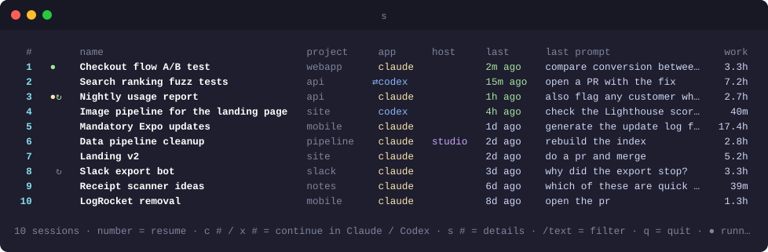
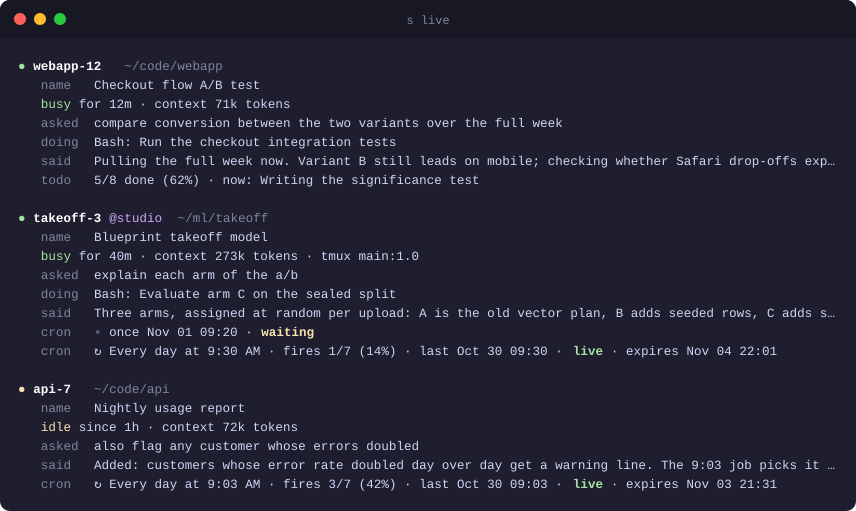
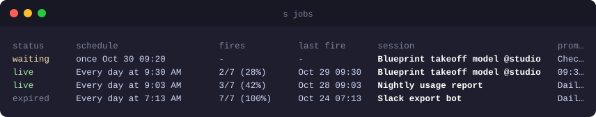
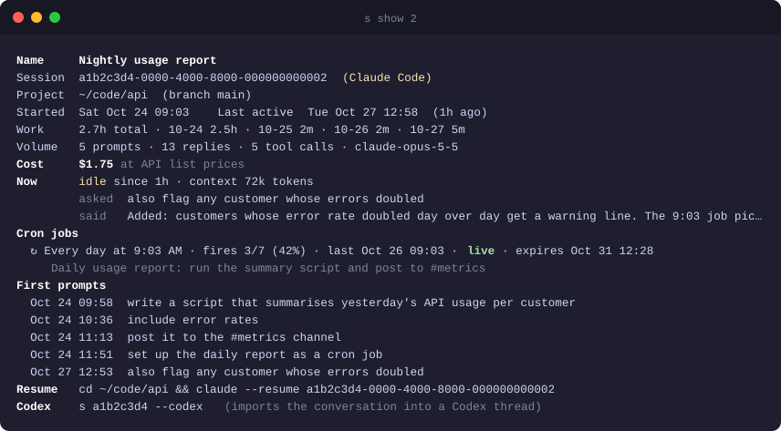
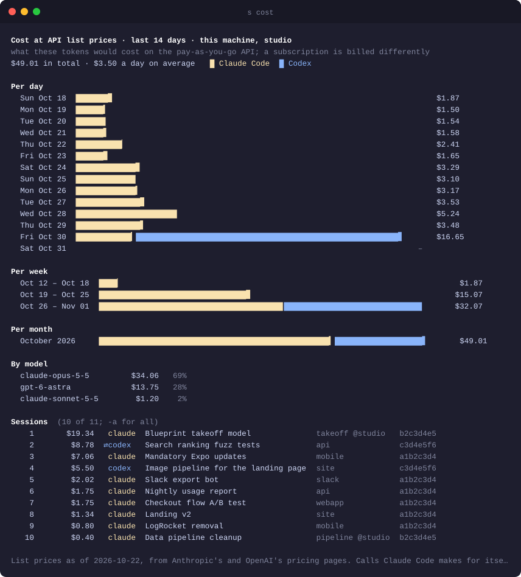

<h1 align="center">sessions</h1>

<p align="center">
  Find, watch and resume every <a href="https://claude.com/claude-code">Claude Code</a> and Codex session you have, on every machine you own. One command: <code>s</code>.
</p>

<p align="center">
  
  
  
  
</p>

<p align="center">
  
</p>

Claude Code and Codex keep each session inside the folder it was started in, so their resume
pickers only ever show you one folder's worth. `s` puts all of them in one list: what each
session was about, how much real work went into it, which ones are running right now, and which
ones have scheduled jobs ticking inside them. Type a number and you are back in that session,
even when it lives on another computer, and in either tool.

## Highlights

- **One list for everything.** Every project, newest first, with the session's name, the hours
  you actually spent in it, and the last thing you asked. Filter by typing.
- **Claude Code and Codex in one list.** If you also use the Codex CLI, its sessions show up
  beside your Claude ones, and any session can be continued in the other tool. A conversation
  that moved between the two stays one row and opens wherever you worked on it last.
- **One memory for both tools.** The companion `ai-bridge` shares memories and MCP servers
  between Claude Code and Codex, with nothing to run once it is set up.
- **See what is running.** `s live` shows each open session: busy or idle, what you asked,
  what it is doing this second, the last thing it said, and how far through its checklist it is.
- **What it costs.** `s cost` charts what your sessions would cost at API list prices, per
  day, week and month, by model and by session, across both tools and all your machines.
- **Scheduled jobs, tracked.** Sessions that set up cron jobs are marked. You see the schedule,
  how many times it has fired, and whether it is still alive or died with the terminal.
- **Your other computers too.** Add a machine once; its sessions join the list. Resuming one
  opens it there over ssh. Sessions running inside tmux are attached, not duplicated.
- **Memories and settings travel with you.** Keep two machines in step with one command,
  in both directions, for Claude Code and Codex alike, with a plan shown first and backups kept.
- **Private by design.** Plain Python files, no dependencies, no accounts, no servers. They read
  what Claude Code and Codex already store on your disk and talk only to machines you name.

## Install

```sh
curl -fsSL https://raw.githubusercontent.com/mohammadnaraghi/sessions/main/install.sh | sh
```

That is the whole setup. It needs `python3` and Claude Code, puts `s` in `~/.local/bin` (with
its companion `ai-bridge`, which does nothing until you run its setup; see
[below](#shared-memory-between-claude-code-and-codex)), and tells you if that folder is not on
your `PATH` yet. Open a new terminal and type `s`.

- Update any time with `s update` (it updates `ai-bridge` too)
- Remove with `rm ~/.local/bin/s ~/.local/bin/ai-bridge`

If you have [fzf](https://github.com/junegunn/fzf) installed, `s` uses it automatically for
fuzzy search with a live preview.

## What is running right now

<p align="center">
  
</p>

`s live` is the view you want when you come back to your desk. For every open session, on
every machine, it tells you what you asked for, which command it is running, what it last
reported, and the checklist progress when the session keeps one. Scheduled jobs that are still
alive are listed underneath.

## Scheduled jobs

<p align="center">
  
</p>

Jobs scheduled inside a Claude Code session only run while that session is open, and they stop
after a week. That is easy to forget. `s jobs` lists every job you ever set up with its
schedule, how many of its possible runs have happened, and a plain status: live, waiting,
done, expired, cancelled, or dead because the terminal closed.

## Every detail of a session

<p align="center">
  
</p>

`s show 2` gives you the full picture before you jump in: when it started, how the work was
spread across days, the first and latest prompts, its jobs, and the exact command that resumes
it.

## What it costs

<p align="center">
  
</p>

`s cost` shows what your sessions would cost at API list prices: what the same tokens would
cost on the pay-as-you-go API, not what a subscription charges you. You get a bar chart per
day, per week and per month (Claude Code and Codex in different colours), the split by model,
and the sessions that cost the most, on every machine you added. It covers the last 30 days;
`-d 90` looks further back, `-a` lists every session, and `s show 3` gives one session's cost.

The numbers are worked out from the tokens each response used, as recorded in the transcripts:
input, output, both cache-write lengths and cache reads, fast mode, US-only inference and web
searches, at Anthropic's and OpenAI's published per-model prices (the date is printed with the
result). A session's subagents and workflow agents count toward it (in Codex too: its subagent
and reviewer threads count toward the thread they worked for), and a conversation that moved
between the tools counts once. Checked against the cost snapshots Claude Code keeps in its
transcripts, they match to the cent for most sessions; the calls Claude Code makes for itself, such as titles and compaction, are not in its
transcripts, so Claude totals can read slightly low.

## Claude Code and Codex

When the [Codex CLI](https://github.com/openai/codex) or the ChatGPT app has been used, its
sessions join the list with an `app` column. `s` reads them straight from Codex's own session
index and files (read-only, cached per thread) and never starts Codex to look. Every `codex`
process shares, and may refresh, your ChatGPT login, and extra ones racing to refresh it can sign
the rest out. Picking a session runs `codex resume` in its folder.

Any session can also be continued in the other tool:

- `s 3 --codex` (or `x 3` in the picker) imports a Claude conversation into Codex as a new
  thread, with the whole history, using Codex's own importer, and opens it. A conversation too
  big for Codex to take whole (over about 150k tokens; Codex models read about 272k) starts a
  fresh Codex thread on Claude's own summary of the earlier work plus the most recent part.
- `s 3 --claude` (or `c 3`) writes the Codex conversation out as a transcript and starts
  Claude Code in the same folder, asking it to read the transcript and say where things stand.
- When the conversation already has a session in the tool you pick (it came from there, or
  went there before), that session is resumed instead of starting a new one. If you worked in
  the other tool since, it also gets a transcript of just that part to read first.

A conversation that moved between the tools stays one row, marked `⇄`, with the work of both
added up. Its number always opens wherever you worked on it last, in that tool, so you never
land in a stale copy. `s show` lists every step of the chain, and `s <session id>` opens one
particular step. `s` recognises the moves it makes itself, Codex's own `/codex:transfer`
imports, and a session that read the other tool's transcript to pick up where it left off.

`s codex` and `s claude` filter the list by tool. Set `SESSIONS_CODEX_ARGS` to pass flags to
every Codex that `s` starts, for example `export SESSIONS_CODEX_ARGS="-p work"` for a profile.

Codex sometimes refuses to start with `account/read failed ... unauthorized (401)`. That
happens when its ChatGPT login was refreshed a moment earlier by another Codex process, such as
the ChatGPT app. A Codex that `s` starts tries once more after a few seconds, and so does
`codex` in a shell set up by `ai-bridge`. If it still fails, `codex login` signs in again. Use
the same ChatGPT account in the app and the CLI: they share one login.

## Shared memory between Claude Code and Codex

`ai-bridge`, installed next to `s`, makes the two tools work as one. Run it once:

```sh
ai-bridge setup                       # or: ai-bridge setup --model gpt-6.1-sol
```

From then on there is nothing to run. You start `claude` or `codex` as usual, anywhere, and:

- **Codex knows what Claude knows.** Each Codex session starts with Claude Code's memories for
  that project, and saves what it learns in Claude's own memory format.
- **Claude learns what Codex learned.** When Claude Code starts in a project, Codex's new
  memories are added to its memory, and Claude is told about them.
- **One set of MCP servers.** The MCP servers you add to Claude Code are copied into Codex: your
  own ones into `~/.codex/config.toml`, a project's `.mcp.json` and local servers into that
  project's `.codex/config.toml` (kept out of git). Servers that log in with OAuth need
  `codex mcp login NAME` once.
- **Pick up where the other left off.** Each tool is told about the other's latest session in
  the folder; ask it to continue where Claude or Codex left off and it reads the transcript.
- **Your model by default.** In zsh, `codex` starts with the bridge's profile (GPT-6 Astra, or
  the `--model` you gave setup), and so do the Codex sessions `s` starts.

| Command | What it does |
|---|---|
| `mem` | what each tool remembers about this folder, and what Codex saved since |
| `mem pull` · `mem show` | move Codex's new memories into Claude now · see what Codex is given |
| `to-codex` · `to-claude` | continue this folder's latest session in the other tool (like `s N --codex` / `--claude`) |
| `cx` | `codex` with the bridge's profile, from shells other than zsh |
| `ai-bridge sync` | copy Claude's MCP servers into Codex now |
| `ai-bridge update` | the latest release (`s update` does this too) |

Setup links those commands next to `ai-bridge` and edits, after backing each one up as
`*.bak-ai-bridge-<time>`: a SessionStart hook in `~/.claude/settings.json`, a SessionStart hook
in `~/.codex/hooks.json` (Codex asks you to trust it the first time), a marked block in
`~/.zshrc`, and `~/.codex/config.toml` (Codex may write its memories, and reads `CLAUDE.md` when
a repository has no `AGENTS.md`). To undo it, remove those hook entries and the marked blocks.
`s hosts setup NAME` copies `ai-bridge` to that machine as well and refreshes it there when it
is already set up.

## Your other computers

```sh
s hosts add studio sam@studio.local   # a name you choose, then the ssh address
s hosts setup studio                  # copies s over, done
```

<p align="center">
  
</p>

From then on the other machine's sessions sit in the same list with a host column, and
`s live` and `s jobs` cover it as well. Picking one of its sessions starts it there inside
tmux, so closing your laptop only detaches you: the session and its scheduled jobs keep
running, and picking it again drops you back into the same window. A session that is already
running there is attached to, never started twice. Add as many machines as you like, Mac or
Linux, any names you want. It needs ssh with keys, the normal setup between your own machines,
and tmux on the other machine for the keep-running part (`brew install tmux` or
`apt install tmux`; without it `s` still resumes over plain ssh and says so).

Want the same safety on this machine? `s --tmux 3` runs a local session inside tmux too.

## Keep two machines in sync

<p align="center">
  
</p>

Claude Code learns things about you and your projects as you work, and keeps them on the
machine you were using. `s sync studio` carries that knowledge, plus your settings, across
both machines in both directions:

- what Claude remembers about each project, and about you (which, with `ai-bridge`, is also
  what Codex remembers)
- your Claude Code settings, instructions, key bindings, custom commands, agents, hooks and skills
- your MCP server list (which `ai-bridge` then gives Codex too)
- Codex's instructions (`AGENTS.md`), hooks and command rules, and the settings in its
  `config.toml` and profiles that belong to you rather than to the machine: model, reasoning
  effort, approvals and permissions, trusted folders and hook approvals. The ChatGPT app's own
  window preferences, plugin paths and feature flags stay as they are on each machine.

Nothing changes until you have seen the plan and said yes. Newer copies win (`--prefer local`
lets this machine win instead), settings and memory indexes are merged rather than overwritten, something you deleted on one machine is
removed from the other, and everything replaced is kept in a dated backup folder first.
Setting up a brand new machine is `s migrate to studio`, which copies everything over and
deletes nothing.

## Cheat sheet

| Command | What it does |
|---|---|
| `s` | the picker: last two weeks, newest first |
| `s 3` | resume number 3, wherever you last worked on it |
| `s 3 --codex` · `s 3 --claude` | continue number 3 in Codex · in Claude Code |
| `s 1a2b3c4d` | open exactly that session (by id), even one step of a `⇄` chain |
| `s tiktok` | filter by any word; resumes at once if only one matches |
| `s running` · `s cron` · `s @studio` | only running sessions, only sessions with jobs, only one machine |
| `s codex` · `s claude` | only Codex sessions · only Claude Code sessions |
| `s cost` | spend at API list prices per day, week and month, by model and session |
| `s live` | what every open session is doing |
| `s jobs` | every scheduled job and its status |
| `s show 3` | the full story of one session |
| `s hosts add NAME user@host` | add another machine, then `s hosts setup NAME` |
| `s sync NAME` | two-way sync of memories and settings, `-n` for a dry run |
| `s migrate to NAME` | set up a new machine from this one |
| `s -d 30` · `s -a` | look back 30 days · show every session, however short |
| `s --tmux 3` | run a local session inside tmux so it survives closing the window |
| `s 3 -- --model opus` | pass extra flags to Claude Code (or Codex) |
| `ai-bridge setup` | share memory and MCP servers between Claude Code and Codex (once) |
| `mem` | what Claude and Codex remember about this folder |

Inside the picker: a number resumes, `c 3` and `x 3` continue in Claude Code or Codex, `s 3`
shows details, `/text` filters, `n` and `p` page, `q` quits. With fzf: enter resumes, alt-c and
alt-x continue in Claude Code or Codex.

## Questions

**Does anything leave my machine?** No. There is no account, no server and no telemetry. The
only network traffic is ssh to machines you added yourself, and the update check when you run
`s update`.

**I use more than one Claude account.** That is fine. Sessions are files on your disk, not
tied to an account, so `s` sees all of them and resumes any of them.

**Will it slow things down?** The first run reads your history once, a few seconds. After that
it opens instantly. Other machines get about a second to answer; one that is asleep or slow is
shown as of its last answer while a fresh one is fetched in the background, and the ssh
connection is kept open for a few minutes so the next run skips the handshake.

**Can I name my machines whatever I want?** Yes. The name is just a label you type; the ssh
address can be a hostname, an IP, or an alias from your ssh config.

**Does resuming change anything?** No. `s` runs the same `claude --resume` or
`codex resume` you would type yourself, in the session's own folder. Continuing in the other
tool resumes the conversation's own session there if it has one, and otherwise creates a new
session there; the original is left untouched either way.

**Why `s`?** It is the shortest thing to type when all you want is to get back to work. The
project is called sessions.

## Requirements

- macOS or Linux
- Python 3.8 or newer, which both already have (3.11 or newer for `ai-bridge setup`)
- Claude Code, and optionally the Codex CLI

## License

MIT
